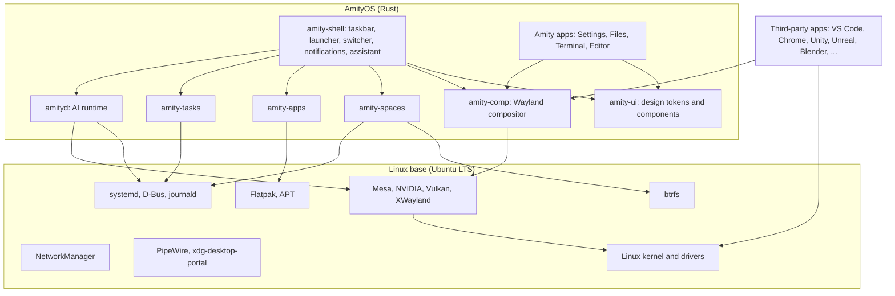

# Architecture

AmityOS is a Linux-based operating system. The Linux kernel and a mainstream distribution
supply drivers, GPU stacks and application compatibility. AmityOS supplies everything the
user sees and the services behind it, written in Rust.
Decision: [0001](decisions/0001-linux-base.md).

## Components

| Component | Role | Built on | Decision |
|---|---|---|---|
| Base OS and image | Kernel, drivers, userland, reproducible image and ISO | Ubuntu LTS, HWE kernel, mkosi | [0002](decisions/0002-base-os-and-image.md) |
| Graphics and media | GPU drivers, Vulkan, X11 apps, audio, capture, portals | Mesa, NVIDIA, XWayland, PipeWire, xdg-desktop-portal | [0003](decisions/0003-graphics-stack.md) |
| `amity-comp` | Wayland compositor: windows, outputs, input, per-Space session and clipboard, blur | Smithay | [0004](decisions/0004-compositor-smithay.md) |
| `amity-ui` | Design tokens and components shared by every Amity surface | iced | [0005](decisions/0005-ui-toolkit-iced.md) |
| `amity-shell` | Taskbar, launcher, MRU switcher, Desktop selector, notifications, control centre, assistant surface. A separate process that the compositor starts and supervises | `amity-ui`, layer-shell | [0008](decisions/0008-shell-process-and-channel.md), [spec](specs/shell-behaviour.md) |
| `amity-ipc` | Message types of the private channel between compositor and shell | serde | [0008](decisions/0008-shell-process-and-channel.md) |
| `amity-spaces` | Spaces: private Home/Project/State storage, hard quotas, shares, isolation, resources | btrfs subvolumes + qgroups, bind mounts, Landlock, systemd user slices | [spec](specs/spaces.md) |
| `amity-apps` | Application catalogue (desktop entries) and launching as systemd user services today; app lifecycle and per-Space app profiles and grants in Phase 5 | Flatpak, portals, APT, systemd | [0007](decisions/0007-apps-and-packaging.md), [0008](decisions/0008-shell-process-and-channel.md), [spec](specs/apps-lifecycle.md) |
| `amity-tasks` | Project tasks: definitions, environment, output, cancellation | transient systemd user units | [spec](specs/tasks.md) |
| `amityd` | AI runtime: provider trait, local and remote models, context grants, VRAM scheduling, "Explain this" | llama.cpp or ONNX Runtime | [0006](decisions/0006-ai-runtime-amityd.md) |
| Amity apps | Settings, Files, Terminal, Editor | `amity-ui`; Terminal on `alacritty_terminal` | |
| Integrations | VS Code extension first; Unity, Unreal and Blender plugins later | `amityd` socket API | |

## Principles

- **Value above the kernel.** We do not compete on schedulers, filesystems or drivers.
- **A workspace per project.** A Space keeps its windows, terminal, storage, apps and
  Amity context together, and isolates them from other Spaces.
- **Ask before acting.** The assistant shows the exact command, commit or install and
  waits for approval. Context reaches a model only through explicit per-Space grants, and
  nothing leaves the machine unless the user enables a remote provider.
- **Service boundaries are D-Bus APIs** with versioned interfaces. Owned daemons run as
  systemd services with least privilege.
- **Licensing.** Owned components link only permissively licensed code
  ([licensing](licensing.md)). Kernel changes are GPL-2.0 and published.

## Development and test environments

| Environment | Use | Limits |
|---|---|---|
| Build root in WSL (Ubuntu 26.04 tree, `tooling/dev.sh`) | `cargo build`/`cargo test`; compositor and shell nested under WSLg (`AmityOS.ps1 nested`) | No DRM/KMS, no real GPU compute; software rendering |
| QEMU VM from `AmityOS.ps1` | Booting the OS image; the compositor on DRM/KMS with a virtual display; acceptance suites driven through the virtual keyboard and pointer; a second virtual monitor | virtio-gpu without 3D: software rendering only; no CUDA/ROCm |
| Real hardware | Hardware-accelerated rendering, real monitors and input devices, NVIDIA/AMD compute, Unity/Unreal, Android emulator | Not available so far. Needed to close the hardware items of Phase 3 and for most of Phase 7 |
