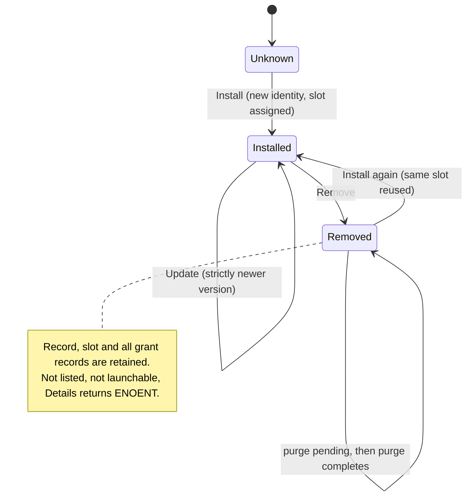

# Application lifecycle specification

This document specifies how AmityOS applications are installed, enabled per Space, granted rights, launched, updated and removed. It was derived from the original AmityOS implementation (the protected application manager "service 4", its client library, the Settings → Applications view, the Desktop compositor's launch/taskbar code, the Desktop configuration format and the native package parser) before that code was deleted, and it is the behavioural reference for the Linux port, where the same concepts are provided by an `amity-apps` daemon that fronts Flatpak (per-Space override sets and portals) and native packages over a D-Bus API. The retired `.amity` container format is not specified here; only the lifecycle, state, permission and licence concepts carried by its manifest are. Statements marked "(inferred)" were reasoned from code paths rather than stated or tested in the original; everything else is direct behaviour of the original code. Sections titled "Port guidance" are recommendations, not derived behaviour.

---

## 1. Terminology

| Term | Meaning |
|---|---|
| Space | An isolated user context with its own storage root, quota, environment and policy. The UI calls a Space a "Desktop". Identified by a non-zero 64-bit storage identity (`space_id`). `0` in a request means "the caller's own Space"; `0` never denotes authority. |
| AppId | Immutable 64-bit application identity. Builtins use `1`–`5`; packages use `>= 0x1000`. Ids `6`–`0x0FFF` are never valid. |
| Slot | A display index (`0`–`31`) assigned once per AppId and never reused, even after removal. Slots are not identities; the UI uses them for icons and taskbar grouping. |
| Version | A three-part `major.minor.patch` string, encoded as a 60-bit integer (each part is 20 bits), compared numerically. |
| Grant record | Per `(AppId, Space)` policy: enabled, autostart, granted permissions, licence-agreement digest. |
| Registry | The manager's durable catalogue of application records and grant records, with a generation counter. |
| Review | A volatile record proving that a specific caller inspected a specific package (path and content hash) in a specific Space. |
| Admin caller | A process whose kernel-authenticated context has the DESKTOP role (the compositor) or the STORAGE_MANAGER role (Settings when the Desktop launched it). |
| Task service | The protected project-task service (see `tasks.md`), which is allowed to launch on behalf of an original requester. |

### 1.1 Builtin applications

| AppId | Slot | Command | Title | Requested permissions | Notes |
|---|---|---|---|---|---|
| 1 | 0 | `files` | Files | read, write, network, clipboard | |
| 2 | 1 | `editor` | Text editor | read, write, clipboard (no network) | |
| 3 | 2 | `terminal` | Terminal | all four | Starts with a safe environment if the Space environment is invalid. |
| 4 | 3 | `settings` | Settings | all four | Cannot be disabled (ECORE). Gets storage-manager authority when an admin caller launches it. Starts with a safe environment if the Space environment is invalid. |
| 5 | 4 | `browser` | Browser | all four | Profile stays at `/STATE/Browser` rather than the generic profile path. |

All builtins report version `0.3.0`, publisher "AmityOS project", licence `/SYSTEM/NOTICE.TXT`, purpose "Bundled native system application" (Browser: "NetSurf native web browser").

---

## 2. Roles and authority

| Caller | May do |
|---|---|
| Any process | `List`, `Details` and `Launch` for its **own** Space only. Asking for another Space returns `EINVAL (-1)`. |
| Admin caller (Desktop, or Settings with storage-manager authority) | Everything an ordinary process may do, for **any** existing Space, plus `Inspect`, `Install`, `Update`, `Remove` and `Configure`. |
| Task service | `TaskLaunch` only, on behalf of an original requester. The target Space is resolved using the requester's authority, not the task service's (§9.4). |
| Anyone | `Status`. |

- Every operation that mutates state, launches or inspects first checks that the target Space exists and is accessible (by querying its storage usage). If it does not, the storage error is returned.
- Mutations are refused with `EROFS (-16)` while the manager is in read-only fence mode (§11.1), and with `EINVAL (-1)` for non-admin callers. A read-only refusal takes precedence.
- Request text inputs (paths, arguments, proofs) must be UTF-8 with no byte below `0x20`, so no tabs or newlines are allowed. Paths are at most 1024 bytes and arguments at most 1024 bytes. Otherwise the result is `EINVAL`, or `EMSGSIZE (-10)` if the client detects it.
- A caller-supplied identity in a request never grants authority. Authority always comes from the kernel-authenticated process context.

---

## 3. Data model

### 3.1 Application record (one per AppId ever known)

| Field | Meaning |
|---|---|
| id, slot | Immutable once assigned. |
| version, version_name | Active version (integer and display string). |
| permissions | The permission set **requested** by the active version's manifest. |
| bytes | Installed payload size (0 for builtins). |
| builtin | true for ids 1–5. |
| installed | false after removal. The record and its slot are kept forever. |
| purge | Set when a removal asked for data deletion and the deletion has not finished yet. Never set while installed. |
| name (≤63 bytes), publisher (≤95), purpose (≤160), command, entry, licence filename | Display and launch metadata. A package's command is `app` followed by the AppId as 16 lowercase hex digits, e.g. `app0000000000001002`. |
| root, previous | Locations of the active version and of the immediately preceding version (both kept on disk). |
| manifest, content hash, program hash | Used to re-validate the program at every launch. |

### 3.2 Grant record (per AppId and Space)

`{ app id, space id, granted permissions ⊆ requested, enabled, autostart (only if enabled), agreement digest (32 bytes, zero = none) }`. At most one record exists per `(app, Space)`.

**Effective state when no record exists for `(app, Space)`:**

| | Builtin | Package |
|---|---|---|
| enabled | **true** | **false** |
| autostart | false | false |
| granted permissions | all requested | all requested (shown, but unusable while disabled) |
| agreement | none | none |

Because of these defaults, a builtin is enabled in every new Space without any write, and a package installed in one Space is disabled in every other Space until an admin enables it there.

### 3.3 Registry persistence

- A single registry file holds a magic/version tag, a generation, the next slot, all application records, all grant records and a SHA-256 trailer over the preceding bytes. It is limited to 512 KiB.
- Every successful mutation increases the generation by exactly 1 (one durable write followed by a filesystem sync). Clients poll `Status.generation` and re-list when it changes: Settings polls about every 2 s, and the Desktop's launcher cache is refreshed at most once a second or immediately when the visible Space changes.
- **Decode is strict.** Any inconsistency rejects the whole file: bad tag or checksum, too many records, duplicate id or slot, `slot >= next_slot`, purge set while installed, permissions outside the four defined bits, a builtin record that does not match the builtin table, a package record whose stored manifest disagrees with its id/version/permissions, a root outside the app's own program directory, a grant naming an unknown app, a grant exceeding the requested permissions, autostart without enabled, a duplicate `(app, Space)` grant, or trailing bytes.
- **Missing registry:** the manager writes the builtin-only defaults (generation starts at 1, then the first persist makes it 2) and continues.
- **Unreadable or corrupt registry:** the manager does not start. It logs "APPLICATION_REGISTRY unavailable; writes and launches denied", and all launches and mutations are unavailable. It never replaces the file with defaults.

### 3.4 Reviews (volatile)

- A review records the caller's process, the Space, the package path, the package content hash, the info summary, the metadata text and the licence text.
- Each caller process has at most one review; a new `Inspect` by the same caller replaces the old one. At most 8 reviews exist in total, and the oldest is evicted first.
- Reviews are lost when the manager restarts. A caller that restarts must review again.

---

## 4. State model

There are four independent states:

1. **Installed**: a global property of the AppId.
2. **Enabled in a Space**: per `(app, Space)`.
3. **Autostart in a Space**: per `(app, Space)`; requires enabled.
4. **Running**: zero or more live processes. Each is bound at launch to an `(AppId, version, Space, permission set)` snapshot that never changes afterwards.

Changing (2) or (3), or the granted permissions, never kills, pauses or re-tags a running process. Switching which Space is visible never re-tags processes.

### 4.1 Registry lifecycle of an AppId



Builtins are created `Installed` and can never leave that state.

### 4.2 Per-Space policy of an installed AppId

```mermaid
stateDiagram-v2
    [*] --> Default
    Default --> Disabled: Configure(enabled=false)
    Default --> Enabled: Configure(enabled=true)
    Default --> Enabled: Install performed in this Space
    Disabled --> Enabled: Configure(enabled=true)
    Enabled --> Disabled: Configure(enabled=false)
    Enabled --> EnabledAutostart: Configure(enabled=true, autostart=true)
    EnabledAutostart --> Enabled: Configure(enabled=true, autostart=false)
    EnabledAutostart --> Disabled: Configure(enabled=false)
    note right of Default
      No grant record. Builtin: behaves as Enabled.
      Package: behaves as Disabled.
    end note
```

Every `Configure` writes the complete record (enabled, autostart, granted permissions, agreement), so "transitions" also carry grant changes (§6).

### 4.3 Transitions and preconditions

Checks run in the order listed. The first failing check determines the result, and nothing is changed.

| Operation | Preconditions (in order) | Effect |
|---|---|---|
| **Inspect** (review) | Admin caller. Space exists. The package at `path` (read in the target Space's file view, ≤16 MiB) parses and validates. Every declared dependency is installed at `>=` its minimum version (`EDEPENDENCY`). | Replaces the caller's review. Returns an info summary, the metadata text (§12.3) or the full licence text. Never executes package content. |
| **Install** | Admin caller. Not read-only. Space exists. The package parses again from `path`. Dependencies are installed. The kernel loader accepts the entry executable. A review exists with the **same caller, Space, path and content hash** (`EREVIEW`). If the manifest requires licence acceptance, the request carries the accept flag (`ELICENSE`). The AppId is not currently installed (`EBUSY`). A new identity needs a free slot (`ENOSPC`). The volume has at least payload + 2 MiB free (`ENOSPC`). The staging location is not occupied by a referenced or running version (`EBUSY`). Staged files write and read back with matching hashes, then sync. | Publishes the version (§8). Replaces the installing Space's grant with `{enabled, all requested, autostart off, agreement = licence digest if accepted, else zero}`. Other Spaces' existing grant records are intersected with the new requested set. Returns the AppId. |
| **Update** | As Install, except: the AppId must be known (`ENOENT`) and must equal the request's AppId, must not be builtin, must be installed, and the new version must be **strictly greater** (all of these give `EEXIST (-8)`). Running instances do **not** block an update. | Publishes the new version and keeps the previous one. Every grant record for the app (all Spaces) is intersected with the new requested set. If accepted, the **installing Space's** existing record gets the new licence digest. No grant record is created. |
| **Configure** | Admin caller. Not read-only. Space exists. The flags contain only enabled, autostart and accept-agreement; autostart without enabled → `EINVAL`. The app is installed (`ENOENT`). Disabling Settings → `ECORE`. Granted permissions ⊆ requested (`EINVAL`). Agreement proof is valid (§7.2, `EREVIEW`). The grant table has room after replacing this Space's record (`ENOSPC`). | Replaces this Space's grant record. Without accept-agreement, the previous agreement digest is kept. |
| **Launch** | Space exists. The app is installed (`ENOENT`) and effectively enabled in the target Space (`EINVAL`). The default launch context can be built (§5.4): an invalid Space environment fails the launch, except for Terminal and Settings. For a licence-required package, this Space's agreement equals the SHA-256 of the active version's licence (`ELICENSE`). The profile directories can be created. The program bytes match the recorded program hash (`-14`) and pass ELF validation. | Spawns a process (§9). Returns its PID. |
| **Autostart** | Performed by the Desktop, not the manager (§9.6). | Same as Launch. |
| **Remove** | Admin caller. Not read-only. Space exists. Only the remove-data flag is allowed. The app is installed (`ENOENT`). Not builtin (`ECORE`). No other installed package declares a dependency on it (`EDEPENDENCY`). **No process anywhere (any Space, any version) belongs to it** (`EBUSY`). | Marks the app uninstalled and persists. Deletes its active and previous program versions where they are unreferenced and not running. If remove-data was requested, deletes its private profile in **every** Space and then clears the purge mark. Grant records are kept. |
| **Recovery** (at manager start) | Registry decoded. | Finishes any pending profile purges. Deletes version directories that are neither active nor previous for an installed app and that no live process is running. Persists if anything changed, and logs "APPLICATION_RECOVERY unreferenced-stages-reclaimed profiles-resumed". |

---

## 5. Per-Space application profiles

### 5.1 Profile locations

| Application | Private profile (inside the launching Space's storage) |
|---|---|
| Browser (AppId 5) | `/STATE/Browser` |
| Every other app, builtins 1–4 included | `/STATE/Applications/A<AppId as 16 UPPERCASE hex digits>`, for example `/STATE/Applications/A0000000000001002` |

- On every launch, the manager creates (or verifies) the profile directory and its `Temp` and `Build` subdirectories in the **target Space**. If creation fails, the launch fails.
- The same AppId has a separate, unrelated profile in each Space. Tests verified that profile contents differ between Spaces.
- Program bytes are shared and immutable across Spaces. Profiles, projects, caches and downloads stay inside the originating Space and count against its quota.

### 5.2 How an application sees `/STATE`

For a process bound to an AppId (the filesystem service enforces this):

- Any path under `/STATE/...` is redirected into that app's own profile in the process's Space. `/STATE/x` resolves to `<profile>/x`, and an explicit path to the app's own profile resolves to itself. The app cannot reach the Space's real `/STATE` root or another app's profile.
- The program directory is readable only for the app's **own** AppId and never writable. Other apps' program directories are denied.
- The file-read and file-write grants are checked **before** the `/STATE` redirect (inferred from order of checks). An app without file-write cannot write even its own profile, and an app without file-read cannot read it.
- Only Desktop, storage-manager and app-manager processes may access the Desktop configuration file.

### 5.3 What is per-Space and what is shared

| Per Space | Shared across Spaces |
|---|---|
| enabled, autostart, granted permissions, licence agreement | installed program versions and manifest |
| private profile and its contents | AppId, slot, display metadata |
| environment document used at launch (§5.4) | |
| working directory default (the Space's folder) | |
| taskbar pins, order and session restore records (§10) | |

### 5.4 Launch context (cwd and environment)

For an ordinary launch, without a task-supplied context:

1. **cwd** is the Space's folder from the Desktop configuration (for example `/HOME` or `/HOME/PROJECT`). If the Space is not found in the configuration, it is `/PROJECT`. It must be at most 1023 bytes, or the result is `EIO`.
2. **User environment**: the Space's environment document, `/STATE/Environment.BIN` in that Space, is read and validated using the rules in `tasks.md` §4. A missing document means empty.
3. **If the document is invalid:**
   - Terminal (3) and Settings (4) launch anyway with an **empty** user environment. The manager logs "LAUNCH_ENV invalid; safe management context; inspect Desktop environment", so the user can repair the document.
   - Every other application **fails closed** with the validation error.
4. The final environment is the user variables in their original order, followed by `PWD=<cwd>`, `AMITY_SPACE_ID=<decimal space id>`, `TMPDIR=/STATE/Temp` and `BUILD_DIR=/STATE/Build`. `HOME=/PROJECT` is appended only if the user did not set `HOME`. The total is at most 2048 bytes and 32 entries. `TMPDIR` and `BUILD_DIR` resolve into the app's private profile through the `/STATE` redirect (§5.2).
5. The environment applies to **every** managed application launch in the Space, not only to project tasks.
6. Values are never written to logs.

---

## 6. Permissions (grants)

### 6.1 The permission set

| Bit | Manifest token | Registry/details label | Settings UI label | Enforced by |
|---|---|---|---|---|
| 1 | `files-read` | Read files | Read Desktop files | Filesystem service: every read-type operation (`EACCES`) |
| 2 | `files-write` | Write files | Write Desktop files | Filesystem service: every write-type operation (`EACCES`) |
| 4 | `network` | Use network | Use the network | Network service: every operation except status, close and DNS-cancel (`EACCES`) |
| 8 | `clipboard` | Use clipboard | Read and write the clipboard | Compositor: clipboard get and set (`EACCES`) |

- An empty set displays as "None".
- The compositor also requires **file-read** for two operations: asking the Desktop to open a package for installation, and starting a Windows program.
- Processes with no AppId (system services) are not subject to these checks.

### 6.2 Request, grant and revoke

- **Request**: a package declares its requested set in its manifest (comma-separated tokens; unknown or duplicate tokens make the package invalid). Builtin requested sets are fixed (§1.1).
- **Initial grant**:
  - On Install, the installing Space gets the full requested set.
  - A Space without a record behaves as "full requested set", but packages are disabled there by default (§3.2).
  - Enabling from Settings re-submits the currently displayed grant, so the full requested set unless it was reduced earlier.
- **Change**: an admin `Configure` sets the exact granted set for one `(app, Space)`. Any subset of the requested set is allowed, and granting outside it → `EINVAL`. The Settings UI toggles one bit at a time and only offers bits the app requested.
- **Revoke**: the same `Configure` operation with fewer bits set.
- **Effect on running processes**: none. "Running instances retain their current rights." New rights apply only to future launches.
- **Update**: all of the app's grant records are intersected with the new version's requested set. Dropped permissions are revoked everywhere. **New permissions are not added** to existing records. They appear only in Spaces that have no record, because of the defaults (inferred).
- There is no runtime prompt. Applications cannot request rights at runtime; grants change only through admin `Configure`.

### 6.3 Permission intersection at launch

The launched process's permission set is:

- `granted(app, Space) ∩ requester's own permission set`, if the requester (the caller, or for task launches the original requester) is itself an application process and is **not** an admin caller;
- `granted(app, Space)` otherwise, that is, when the Desktop, Settings with storage-manager authority, or a non-application system process launches.

Example: Terminal launches app X. X's granted set is {read, write, network}, and Terminal's own set in that Space is {read, write, clipboard}. X runs with {read, write}.

---

## 7. Licence acceptance

### 7.1 Package declaration

- `license` names a bundled UTF-8 text file (1 byte to 64 KiB, required for every package).
- `license-acceptance` is `none` or `required`.
- `agreement-version` is a non-empty display label of at most 64 bytes when acceptance is required. It is shown, but consent is bound to the licence **digest**, not to this label.
- Accepting a licence is consent to its terms. It is not permission to redistribute the package.

### 7.2 Where acceptance is recorded and checked

| Point | Rule |
|---|---|
| Install / Update | If required, the request must carry an explicit accept flag, otherwise `ELICENSE (-41)` before any change. The Settings review dialog disables its Install/Update button until "I accept these license terms" is ticked; pressing it unticked switches to the License tab. On success, `agreement = SHA-256(licence bytes)` is recorded for the installing Space (Install: new record; Update: existing record only). |
| Re-check before submit | The Settings client re-reads the metadata and licence texts just before submitting. If either differs from what was displayed, it refuses with `EREVIEW`. |
| Enabling in another Space | If the user enables a disabled app whose package requires acceptance, Settings opens an "Application terms" dialog showing the full licence. Its "Enable" button requires the tick-box. Settings then sends `Configure` with accept-agreement, `offset = the exact installed version it displayed`, and an input of exactly 64 hex characters: the SHA-256 of the **UTF-8 licence text it displayed**. |
| Service validation of a proof | Refused with `EREVIEW (-42)` if the app is builtin, the version is not the current installed version, the input is not exactly 64 hex characters, or the digest does not match (case-insensitive) the current licence file. Refusal happens **before** any change: generation and grants stay unchanged. |
| Configure without acceptance | `offset` must be 0 and the input empty, or `EREVIEW`. The previous agreement digest is kept unchanged. |
| Client-side guard | A request that "accepts" without supplying the frozen version and text is refused by the client library with `EREVIEW`. Bare boolean consent is never sent. |
| Launch | A licence-required package launches only if this Space's agreement equals the digest of the **active version's** licence file, otherwise `ELICENSE`. |
| Licence change on update | Other Spaces keep the old digest, so their launches fail with `ELICENSE` until the new terms are accepted there. A proof that names the old version is refused with `EREVIEW`. An update whose licence bytes are unchanged leaves existing acceptances valid (inferred). |
| Builtins | Never require acceptance. Their licence view shows "Bundled notices: open /SYSTEM/NOTICE.TXT in Text editor for the complete offline licence texts." |

---

## 8. Install, update and remove behaviour

### 8.1 Publication order (install and update)

1. Validate the package (format, manifest, dependencies, kernel-loader acceptance of the entry executable, review match, licence flag, identity and version rules, capacity, free space).
2. Stage every file into a new immutable version directory named after the version and the first 16 hex digits of the content hash, under the app's own program directory. Then write a manager-owned `manifest.txt`, read each file back and verify its hash, and sync. A staging failure removes the staging directory, unless the failure was an unknown-outcome or read-only storage error.
3. Update the in-memory registry and grants, then persist with one atomic write followed by a sync. **Publication is that single write.** No partially staged version is ever launchable.
4. After publication:
   - release any cached executable of the old version;
   - try to reclaim the version **before** the previous one (it is not reclaimed if it is still running).

   Two versions are kept: active and previous.

### 8.2 Failure and outcome semantics

- **Persist fails with a definite error:** the in-memory registry is rolled back and the staged files are deleted.
- **Persist fails with an unknown outcome or read-only error** (`EOUTCOME (-15)` / `EROFS (-16)`): publication may already be durable. The manager **does not roll back and does not delete** the staged files. It enters read-only fence mode: every further mutation returns `EROFS` until the manager restarts and recovery runs.
- **Client loses the reply:** if the transport fails after a mutation was submitted, the client reports `EOUTCOME (-15)` and **never retries automatically**. The UI tells the user to refresh and check before repeating.
- **Settings is closed:** closing Settings while a mutation is pending does not cancel the mutation. The progress dialog says so.

### 8.3 What is preserved

| Item | Update | Remove (default) | Remove + delete data | Reinstall after remove |
|---|---|---|---|---|
| AppId and slot | kept | kept (record hidden) | kept (record hidden) | same slot reused |
| Grant records in other Spaces | kept, intersected | kept | kept | kept, intersected with the new version |
| Grant record in the acting Space | kept, intersected; agreement refreshed if accepted | kept | kept | replaced: enabled, full grants, no autostart |
| Enabled and autostart flags | kept | kept (but not launchable) | kept | see above |
| Private profiles, all Spaces | kept | **kept** | **deleted in every Space** | whatever existed is reused |
| User files outside profiles | kept | kept | kept | kept |
| Running instances | keep running on the old version | removal refused while any exist | removal refused while any exist | n/a |
| Previous version on disk | becomes "previous" | reclaimed if unreferenced and not running | same | n/a |

Profile deletion with remove-data:
- It covers only package AppIds (`>= 0x1000`), never builtins.
- It is limited to 4096 filesystem entries and a directory depth of 12 in total, otherwise `EIO`.
- It is resumable: the purge mark survives a crash and recovery finishes it.
- If it fails partway, the error is shown with the suffix "Some application data may already have been deleted."

### 8.4 Dependencies

- A package may declare up to 8 dependencies, each `AppId@minimum-version`, with distinct ids and never itself.
- Inspect and Install require every dependency to be installed at a version `>=` its minimum.
- Remove is refused while any other installed package declares a dependency on the app.
- There is no automatic resolver, repository download or install script.

### 8.5 Builtins

Builtins cannot be updated (`EEXIST` at the service; the Settings review pre-check reports `ECORE`) and cannot be removed (`ECORE`). They change only with an OS release.

---

## 9. Launch rules

### 9.1 Who may launch, and into which Space

- Any process may launch an enabled application into **its own** Space.
- Only admin callers may name another Space. The Desktop launches into the Space where the user acted, which is the visible Space or, for session restore, the record's Space.
- The task service may launch only through `TaskLaunch`, on behalf of a requester (§9.4).
- Legacy raw executable-name launch paths cannot start a builtin by name. They return `EACCES`, so every application launch goes through the registry checks.

### 9.2 Launch arguments

Arguments are one UTF-8 string of at most 1024 bytes with no control characters. The meaning is application-defined, for example a document path. A launch hint never supplies identity, namespace or authority.

### 9.3 Binding

The kernel binds the new process to an immutable snapshot of `(AppId, version, permission set, Space)`, plus the launch context (cwd, environment, original requester). Settings launched by an admin caller additionally gets storage-manager authority. No other app can obtain that authority through a launch.

### 9.4 Task launches

- The task service supplies a complete launch context: cwd, merged environment, original requester and output owner.
- The manager accepts it only if the context names the same requester as the request, names the calling task service as output owner, and has exactly the "capture output" flag.
- The target Space and the permission intersection (§6.3) are computed from the **requester's** authority.
- A captured task process cannot spawn further processes (single-process jobs) and can never receive storage-manager authority. See `tasks.md`.

### 9.5 Desktop launch queue

- The Desktop keeps a FIFO of at most 32 launch intents. Only the head is submitted, and only one launch request is in flight per Desktop process.
- An intent not submitted within 30 s is dropped with "Application launch timed out before submission. Try again."
- A submitted launch waits up to 15 s. A transport loss is reported as "Launch outcome is unknown. Check running applications before retrying." and is not retried.
- The total of open windows, pending windows and queued launches is capped at the compositor's window limit: "Window resources are exhausted. Close an application and try again."

### 9.6 Autostart

- About once a second, while no launch is in flight, the Desktop examines the **visible** Space.
- For every app that is both enabled and autostart there, and that has not yet been autostarted in that Space during this Desktop session, the Desktop records `(Space, AppId)` and launches the app. The launch is skipped if the app already has a window, a pending launch or a live process in that Space.
- Autostart therefore happens at most once per `(Space, app)` per Desktop session, and only when the Space is first shown (inferred: a Space never made visible does not autostart).
- At most 1024 such memo entries are kept.

### 9.7 Focus on launch (presentation only)

A newly created window is activated only if:
- it belongs to the visible Space and is not minimized; and
- either no focus intent applies, or the applicable intent requests "new window" or "active", or the window asked not to take focus. (The last condition is kept as found; see Open questions.)

Which intent applies:
- A saved, authenticated session-restore intent takes precedence.
- Otherwise the intent of an in-flight launch applies, but only if it matches the window's AppId **and** Space.
- An unrelated pending launch can never steal or suppress focus.

---

## 10. Taskbar pinning, order and session data that belong to apps

These are stored per Space in the Desktop configuration, not in the application registry.

| Data | Scope | Rule |
|---|---|---|
| Pins | per Space, builtins only | A 5-bit set indexed by builtin slot. Default: all five pinned. Toggled from a builtin's taskbar context menu ("Pin"). Installed packages cannot be pinned. |
| Task order | per Space, builtins only | A permutation of the five builtin slots. Default: Files, Text editor, Terminal, Settings, Browser. Changing pins never changes the order. |
| Reorder | | Dragging builtin A onto builtin B moves A into B's position, and the items between shift one place toward A's old position (remove-then-insert). Dropping onto or from a non-builtin item changes nothing. Invalid permutations make the configuration invalid. |
| Taskbar contents | | 1. Builtins in task order that are (pinned **and** enabled in this Space) **or** have a pending launch **or** have windows. 2. Then any other app with a pending launch or windows, in registry slot order. 3. Then, last, a single "Windows applications" group if Windows-program windows exist. |
| Session restore | per window | `{ AppId, Space id, window id, flags (bit0 minimized, bit1 maximized, bit2 active), logical geometry, document argument ≤1023 bytes }`. At most 64 records in total. Saved only for Spaces whose "restore session" setting is on. Records can name builtins or packages. At restore, a record whose AppId is no longer installed or available is skipped but kept for a later attempt. Records for a removed Space are dropped. |
| Migration | | Older configuration versions (four builtins) migrate with the order extended by Browser at the end. Pins migrate unchanged, so Browser starts **unpinned** after migrating from those versions (inferred). |

---

## 11. Limits

| Limit | Value | Error when exceeded |
|---|---|---|
| Application identities in the registry (including 5 builtins), lifetime, slots never reused | 32 (so 27 distinct package AppIds ever) | `ENOSPC (-6)` on Install of a new AppId |
| Grant records | 1024 | `ENOSPC` on Configure |
| Registry size | 512 KiB | `EIO (-7)` |
| Volatile reviews | 8 total, 1 per caller | oldest evicted |
| Package size / files / manifest | 16 MiB / 16 files / 16 KiB | `EIO` (too large) |
| Licence text | 1 byte–64 KiB UTF-8 | `EINVAL` |
| Icon (optional) | QOI, ≤256 KiB, 1–256 × 1–256 px | `EINVAL` / `EIO` |
| Dependencies | 8 | `EIO` |
| Name / publisher / purpose / provenance / version text / filenames | 63 / 95 / 160 / 160 / 24 / 64 bytes | `EINVAL` |
| Version parts | exactly 3, each ≤6 decimal digits and < 2^20 | `EINVAL` |
| Free space required to stage | payload + 2 MiB | `ENOSPC` |
| Launch arguments / paths | 1024 bytes | `EINVAL` / `EMSGSIZE` |
| List / details / licence reply buffer | 64 KiB | `EIO` |
| Profile purge | 4096 entries, depth 12 | `EIO` |
| Desktop launch queue | 32 intents; 30 s before submission; 15 s reply | message (§9.5) |
| Autostart memo | 1024 (Space, app) pairs per Desktop session | stops autostarting |
| Session restore records | 64 | `ENOSPC` |
| Spaces in the Desktop configuration | 32 | `ENOSPC` |

### 11.1 Read-only fence

If a registry write or its sync fails with an unknown outcome or a read-only storage error:
- the manager sets read-only mode, and `Status` reports `read_only = 1` and the last error;
- all mutations return `EROFS (-16)`, and Settings disables Install, Update, Uninstall and every toggle;
- launches continue. Only a restart with successful recovery clears the fence.

---

## 12. Errors and user-visible messages

### 12.1 Codes used by the manager

| Code | Name | Meaning in this subsystem |
|---|---|---|
| -1 | EINVAL | Not allowed or malformed: wrong role, wrong Space, bad flags, permission outside requested set, app disabled at launch, invalid manifest or unsafe name |
| -2 | ENOENT | App not installed or unknown; required file missing in package |
| -3 | EACCES | Rights denied by the filesystem, network or compositor; raw builtin launch refused |
| -5 | EBUSY | App has running instances (remove); AppId already installed (install); staging slot in use |
| -6 | ENOSPC | Identity, grant or free-space capacity |
| -7 | EIO | Too large, or I/O failure |
| -8 | EEXIST | Update not to a strictly newer version of the same non-builtin installed app; **also** wrong ABI or architecture in a package (overloaded) |
| -14 | (format) | Integrity or format failure (hash mismatch, corrupt record). The shared error table labels −14 as a storage-quota error (§14). |
| -15 | EOUTCOME | Outcome unknown after a transport or storage interruption; never auto-retried |
| -16 | EROFS | Manager or storage is read-only |
| -40 | EDEPENDENCY | A dependency is missing or too old (install/inspect), **or** a dependent package exists (remove) |
| -41 | ELICENSE | Licence acceptance missing (install/update) or not recorded for the current licence in this Space (launch) |
| -42 | EREVIEW | No matching review; package changed since review; agreement proof missing, stale or malformed |
| -45 | ECORE | Core component: cannot disable Settings, cannot remove or update builtins |

### 12.2 Settings → Applications messages

| Situation / code | Message |
|---|---|
| EDEPENDENCY | A required application or runtime is missing or too old. |
| ELICENSE | Review and accept the bundled terms before enabling this application. |
| EREVIEW | The package changed after review. Select and review it again. |
| ECORE | This system component must stay available. Update it through an OS release. |
| -15 | Commit outcome unknown. Refresh the installed list before repeating this operation. |
| -16 | Application storage is read-only. Check storage recovery before retrying. |
| -5 | Close this application's open windows, then retry. Existing files are retained. |
| -8 | Choose a newer version of this same application to update it. |
| -1, -3 | This operation is not allowed. Check application rights, Desktop selection and package format. |
| other | `<generic storage error text> (<code>).` |
| Configure succeeded | Desktop application policy saved. Running instances retain their current rights. |
| Mutation in progress | `<name> Installing…` / `Updating…` / `Removing…`, with a modal: "Please wait while the operation finishes." · "Keep this window open to see the result." · "Closing Settings does not cancel this operation." |
| Mutation finished | `Installed <name>` / `Updated <name>` / `Uninstalled <name>` |
| Remove-with-data failed | `<error message> Some application data may already have been deleted.` |
| Refresh | Installed list refreshed |
| Open | Application launched |
| Terms accepted | Application operation completed |
| Empty list | Application manager unavailable. Try Refresh. |
| Header | Installed once. Enabled and configured separately for each Desktop. |
| Settings selected | Settings stays enabled so you can manage applications. |
| Uninstall dialog | Title "Uninstall application?" · "Close this application's windows before removing its program files." · "By default, private application data is kept in every Desktop." · toggle "Also delete this application's data in ALL Desktops" · "Data deletion is permanent and requires all instances to close." · button "Uninstall", or "Delete all data" when the toggle is on |
| Toggles | Enabled in this Desktop · Start when this Desktop opens (disabled unless enabled) · the four permission labels from §6.1 (only requested bits are toggleable) |
| Dialog titles | Review application package · Review application update · Application terms · Application information |

### 12.3 Informational texts produced by the manager

**Package review metadata** (one item per line):
1. `<name> <version>`
2. `Publisher claim: <publisher>`
3. `Unsigned package; publisher identity is unverified.`
4. `Source claim: <provenance>`
5. `SHA-256 content hash:`
6. `<first 32 hex>`
7. `<last 32 hex>`
8. `Requested permissions: <labels>`
9. `Payload bytes: <n>`
10. `<purpose>`
11. `Terms acceptance: required|not required`

**Installed details** (one item per line):
1. `<name> <version>`
2. `Publisher: <publisher>`
3. `Bundled system component` or `Unsigned local package`
4. `Provenance: OS release` or `Provenance: Unverified package claim`
5. `Integrity does not authenticate a publisher.`
6. `Permissions: <labels>`
7. One of:
   - `Storage: included in the shared OS boot archive; not individually metered` (builtins)
   - `Installed payload bytes: <n>` (packages)
8. `<purpose>`

**Trust statement**: hashes detect changed content only. Neither a matching hash nor the publisher string authenticates a publisher. Every package is flagged UNSIGNED.

### 12.4 Desktop messages

- Application is unavailable. Open Applications in Settings.
- Desktop storage is not ready. Open recovery diagnostics.
- Window resources are exhausted. Close an application and try again.
- Not enough memory to launch an application.
- Application launch timed out before submission. Try again.
- Launch outcome is unknown. Check running applications before retrying.

---

## 13. Port guidance (not derived from the original code)

| Original concept | Suggested Linux mapping |
|---|---|
| Builtin apps 1–5 | Native packages in the OS image, with the same registry, policy and launch checks. Keep "cannot remove; Settings cannot be disabled". |
| Installed packages | Flatpak apps (or signed native packages) recorded in the `amity-apps` registry under an AmityOS AppId mapped to the Flatpak ref. Keep the review → install binding to the bundle's content hash. |
| Per-Space grants | Compute the sandbox arguments at each launch from `(app, Space)`, for example per-Space override sets or `flatpak run` arguments for filesystem and network. Global per-user `flatpak override` cannot express per-Space policy on its own. |
| Clipboard grant | No Flatpak permission exists; the compositor must enforce it, as the original compositor did. |
| Private profile | A per-Space directory, e.g. `<space-state>/Applications/<AppId>`, presented to the app as its XDG data, config and cache home (and its Temp/Build directories). Browser keeps a distinct legacy profile name only if migration needs it. |
| Running-instance binding | Record `(AppId, version, Space, permissions)` per process or cgroup at launch, and never re-tag it. |
| D-Bus API | One method per operation in §4.3, e.g. `List(space)`, `Details(id, space, kind)`, `Inspect(path, space, kind)`, `Install(path, space, accept)`, `Update(id, path, space, accept)`, `Remove(id, remove_data)`, `Configure(id, space, enabled, autostart, permissions, reviewed_version, licence_sha256)`, `Launch(id, space, args)`, `Status()`, plus a `GenerationChanged` signal. Authenticate callers by peer credentials, never by message fields. Map the error codes in §12.1 to named D-Bus errors and keep them distinct (fix the overloads listed in §14). |

---

## 14. Test vectors

Unless stated otherwise:
- S1 and S2 are distinct existing Spaces.
- P1 is a valid package with AppId `0x1001`, version `1.0.0`, requesting {read, write}, licence acceptance `none`.
- "admin" means a Desktop or Settings-manager caller in S1.

| # | Given | Action | Expected |
|---|---|---|---|
| A1 | Fresh registry; new Space S3 with no grant records | Any process in S3 calls `List(0)` | Five entries, ids 1–5, each BUILTIN + ENABLED, no AUTOSTART, granted = requested (Files 15, Editor 11, Terminal 15, Settings 15, Browser 15). |
| A2 | P1 not reviewed by this caller | admin `Install(P1, S1)` | `EREVIEW (-42)`; generation unchanged. |
| A3 | admin `Inspect(P1, S1)` succeeded; then P1's bytes on disk are replaced by a different valid package at the same path | admin `Install(P1, S1)` | `EREVIEW`; nothing staged or published. |
| A4 | Reviewed P1 | admin `Install(P1, S1)` | Returns `0x1001`. `List(S1)`: ENABLED, REMOVABLE, UNSIGNED, granted 3. `List(S2)` (by admin, or by a process in S2): present, **not** ENABLED, granted shown as 3. `Launch(0x1001, S2)` → `EINVAL (-1)`. |
| A5 | A4 | admin `Configure(0x1001, S2, enabled, no autostart, permissions = read)`; then launch in S2 | The new process's permission set is exactly {read}. Its profile `/STATE/Applications/A0000000000001001` in S2 is separate from S1's. |
| A6 | A4 | admin `Configure(0x1001, S1, enabled=false, autostart=true, 3)` | `EINVAL`; record unchanged. |
| A7 | A4 | admin `Configure(0x1001, S1, enabled, -, permissions = network)` | `EINVAL` (network is not requested). |
| A8 | Any | admin `Configure(4 /*Settings*/, S1, enabled=false, …)` | `ECORE (-45)`; generation and grants unchanged. |
| A9 | P2 = AppId `0x1002` with acceptance `required` and licence text L | admin Install without the accept flag; then with it | First: `ELICENSE (-41)`. Second: installed; the S1 agreement equals SHA-256(L); `Launch` in S1 succeeds. |
| A10 | A9 | admin `Configure(0x1002, S2, enabled, accept-agreement)` with proof = 64 × `0`, then 64 × `g`, then an empty proof | Each returns `EREVIEW`; generation unchanged. Then with version = installed version and proof = hex SHA-256(L): success, generation +1, and `Launch` in S2 succeeds. |
| A11 | A10; P2 v2.0.0 has licence L2 ≠ L; admin in S1 updates with accept | `Launch(0x1002, S2)`; then an S2 proof naming version 1.0.0 with SHA-256(L); then an S2 proof naming 2.0.0 with SHA-256(L2) | `ELICENSE`; `EREVIEW`; success. |
| A12 | P1 installed at 1.0.0 | Update to 1.0.0 again; to 0.9.0; Update naming AppId 4; Update with a package whose id differs from the request | `EEXIST (-8)` in each case. |
| A13 | P1 1.0.0. S1 grant {r,w}, S2 grant {r}, S3 no record. P1 v1.1.0 requests {r, network} | admin Update | S1 → {r}, S2 → {r} (network **not** added), S3 shows {r, network} but disabled. Slot and AppId unchanged. |
| A14 | A process X runs P1 1.0.0 in S1 | Update to 1.1.0; then disable P1 in S1 | X keeps running, reports version 1.0.0 and its original permissions. New launches in S1 → `EINVAL`. |
| A15 | X from A14 is still running | admin `Remove(0x1001)` | `EBUSY (-5)`. After X exits: success. `Details(0x1001)` → `ENOENT`; `Launch` → `ENOENT`; the S1 profile is byte-identical to before. |
| A16 | P3 declares `dependency=0000000000001001@1.0.0`, both installed | admin `Remove(0x1001)` | `EDEPENDENCY (-40)`. |
| A17 | P1 removed with remove-data. Earlier S2 had grant {r} enabled | Inspect and reinstall P1 from S1 | The profiles in S1 and S2 are gone before the reinstall. After reinstall: same slot as originally; S1 = enabled, {r,w}, no autostart; S2 = its old record {r}, enabled. |
| A18 | 27 distinct package AppIds have been installed at some point (any may be removed) | Install a 28th new AppId; reinstall one of the 27 | `ENOSPC (-6)`; the reinstall succeeds. |
| A19 | Terminal (an app, not admin) in S1 has permissions {r,w,clipboard}. App Y is granted {r,w,network} in S1 | Terminal launches Y; the Desktop launches Y | Y runs with {r,w} when Terminal launches it; with {r,w,network} when the Desktop does. |
| A20 | An ordinary process in S1 | `List(S2)` | `EINVAL`. |
| A21 | The S1 environment document contains `1BAD=x` | Desktop launches Text editor in S1; Desktop launches Terminal in S1 | Editor fails with `EINVAL`. Terminal starts with no user variables, and the manager logs the safe-context notice. |
| A22 | Version strings | Parse `1.2.3`, `1.0.0`, `1.2.3.4`, `1048576.0.0`, `1.2` | `0x0000010000200003`, `0x0000010000000000`, invalid, invalid, invalid. |
| A23 | Task order `[Files, Editor, Terminal, Settings, Browser]` | Drag Files onto Settings; then, from the original order, drag Browser onto Editor | `[Editor, Terminal, Settings, Files, Browser]`; `[Files, Browser, Editor, Terminal, Settings]`. |
| A24 | Registry file with one flipped byte | Manager start | The manager refuses to run and logs "APPLICATION_REGISTRY unavailable; writes and launches denied". The file is not overwritten. |

---

## 15. Code/doc disagreements found during extraction

1. **Restore of installed apps.** The package document says pin ordering and window-geometry restoration for external packages are "not yet added to C06". The code uses a newer configuration version, C07, that stores an AppId per restore record, accepts package AppIds (`>= 0x1000`), saves windows of any app with an AppId, and resolves them through the registry at restore. Window restore for packages therefore appears implemented (inferred). Pins and order remain builtin-only, which agrees with the document.
2. **Environment scope.** The Settings environment editor says "Values apply to new project tasks in this Desktop". The manager in fact applies the Space environment to **every** managed launch in the Space, and an invalid document blocks all launches except Terminal and Settings.
3. **Review binding.** The document says the review must match caller, Space and content hash. The code additionally requires the same **path**.
4. **Misleading error texts caused by overloaded codes:**
   - Installing an already-installed AppId returns `EBUSY`, and Settings shows "Close this application's open windows…".
   - A package with the wrong ABI or architecture returns `EEXIST (-8)`, shown as "Choose a newer version of this same application…".
   - Remove blocked by a dependent package returns `EDEPENDENCY`, shown as "A required application or runtime is missing or too old."
   - Integrity and format failures use `-14`, which the shared error table renders as "Desktop storage limit reached…".

   The package parser has accurate messages ("Package integrity failed. Obtain an intact package.", "This package requires another architecture or AmityOS ABI.", "Unsafe package filename or destination rejected.", "A required executable, icon or licence is missing.", "The package manifest is inconsistent or unsupported.", "The package exceeds the supported resource limits."), but the UI never uses them. The port should use distinct codes.
5. **Icons.** The document says installed packages use generic artwork. The manager reports the display slot as the icon index for packages and builtins alike, and any fallback happens in the drawing code (inferred).

---

## 16. Open questions

1. **Grant-record cap on Install.** Install adds a grant record without checking the 1024-record cap, while decode rejects more than 1024. Grant records for deleted Spaces are never removed (inferred), so the cap could in principle be exceeded and make the registry unreadable at the next start. Should the port garbage-collect grants of deleted Spaces and check the cap on Install?
2. **Update from a Space with no grant record.** Updating with acceptance from such a Space records no agreement anywhere. Should Update create or refresh the acting Space's record?
3. **Unused "previous" version.** Two versions are kept, but no rollback operation exists. Should the port expose rollback, or keep the previous version only for running instances and resources?
4. **Focus rule.** The rule activates a window whose launch asked for no focus (`… || no_focus`). This looks inverted relative to the flag's name. Confirm the intended behaviour before porting.
5. **Autostart timing.** Autostart fires only for the visible Space, and once per Desktop session. Should a Space that is never shown autostart its apps, and should autostart re-fire after a Desktop restart within the same login?
6. **Flatpak permissions.** Are four permission bits enough? Flatpak exposes finer-grained rights (devices, portals, D-Bus names). Decide whether they map onto these four bits or extend the model.
7. **Read-only fence recovery.** The original recovers only by restarting the manager. Should the port offer an explicit "retry publication" path?
8. **Raw spawn of non-builtin executables.** Terminal `run PROGRAM` raw-spawns non-builtin boot executables outside the registry. That has no Linux analogue; confirm it is dropped.
