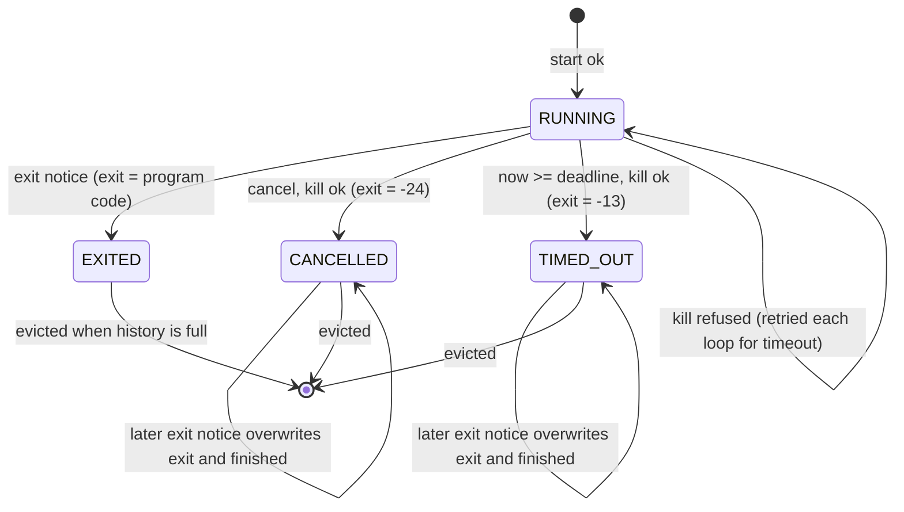

# Project tasks specification

This document specifies AmityOS project tasks: named, per-Space definitions of a command to run with an installed native application, the per-Space project environment, the supervised execution of task jobs with bounded output capture, cancellation, timeouts and exit reporting, and the Terminal commands that drive them. It was derived from the original AmityOS implementation before that code was deleted. The sources were the protected task service ("service 6"), its client library, the definition and environment rules, the Terminal's task and environment commands, the Settings environment editor, and the kernel's task-output and exit-notice path. It is the behavioural reference for the Linux port, where an `amity-tasks` daemon runs each job as a transient systemd user unit in the Space's slice. Statements marked "(inferred)" were reasoned from code paths rather than stated or tested in the original. Sections titled "Port guidance" are recommendations, not derived behaviour. Application identity, enablement and grants are specified in `apps-lifecycle.md`.

---

## 1. Principles

- A definition is **data, not a script**. Nothing runs because a directory, package or Space was opened, or because a definition was saved. Every execution is an explicit `run`/`exec` request.
- Tasks run **installed package applications only** (AppId `>= 0x1000`). Builtin applications cannot be task programs. There is no shell, no POSIX pipes, no redirection and no variable expansion.
- `build`, `test` and bare `run` execute only definitions explicitly named `build`, `test` and `run`. A missing definition or tool is an error, never a synthesized success. Git or compiler support exists only if a real package is installed and a definition names its AppId. No repository status is fabricated.
- Accepted mutations and launches are **never replayed automatically**. A lost reply is reported as "outcome unknown".
- Definitions and the environment are durable per Space. Job records and output are bounded, volatile RAM state.

---

## 2. Callers and Space targeting

| Caller | Allowed |
|---|---|
| Desktop compositor, or Settings holding storage-manager authority | All operations, for its own Space or any named existing Space |
| Terminal (the process's application identity is the builtin Terminal, AppId 3) | All operations, **own Space only** |
| Anything else (ordinary applications, Settings without manager authority (inferred)) | Nothing: `EACCES (-3)` |

Space targeting rules:
- Space `0` in a request means the caller's own Space.
- Naming another Space without manager authority → `EACCES`.
- The target Space must exist and be accessible, otherwise the storage error is returned.
- Every operation is evaluated inside the target Space's storage view, so its `/STATE` is that Space's managed state root.
- Cross-Space job IDs are not visible: `log`/`cancel` of a job that belongs to another Space returns `ENOENT (-2)`, not `EACCES`.

---

## 3. Task definitions

### 3.1 Fields and validation

| Field | Rule | Error if violated |
|---|---|---|
| name | 1–32 bytes of ASCII letters, digits, `_`, `-` | `EINVAL (-1)` |
| app | AppId `>= 0x1000` (an installed package; installed/enabled is checked only at run time) | `EINVAL` |
| cwd | Absolute (starts with `/`), ≤1023 bytes, no control characters. **Not** checked for existence at define time. At run time it must exist (`ENOENT`) and be a directory (`EINVAL`). | `EINVAL` |
| args | One argument string, ≤1023 bytes, no control characters. Passed verbatim to the program, whose own parser interprets quoting. | `EINVAL` |
| env | Per-definition variables, same rules as the Space environment (§4.1). Empty when created from Terminal. | `EINVAL` / `EIO (-7)` |
| timeout | 1–36000 ticks. A tick is 10 ms, so 0.01 s – 360 s. | `EINVAL` |

### 3.2 Storage

- Each definition is stored in the target Space at `/STATE/Tasks/Definitions/<name>.task`. The service creates `/STATE/Tasks` and its `Definitions` subdirectory on define and on every start.
- The record is versioned and self-describing. In the original it was an 8-byte magic tag, the AppId and timeout as little-endian 64-bit integers, and then name, cwd, args and env as length-prefixed UTF-8 strings. A SHA-256 over all preceding bytes closes the record. Total size is 72 bytes to 8 KiB.
- A record that fails length, tag, hash or field validation is **corrupt**. It is never executed, never rewritten and never deleted automatically.
- The port may change the encoding but must keep the bounds, the integrity check and the "corrupt is preserved and reported" behaviour.

### 3.3 Operations

| Operation | Behaviour |
|---|---|
| **Define** | The service decodes and validates the client's record. If `<name>.task` does not exist yet and the directory already holds 32 or more entries (valid, corrupt or other files), it fails with `ENOSPC (-6)`. Otherwise it writes the record, **replacing an existing definition with the same name**, and syncs. A sync failure is reported as `EOUTCOME (-15)`. |
| **List definitions** | Returns one text line per non-directory entry, in directory order. A valid record gives `<name>  app<AppId as 16 lowercase hex>  <cwd>  [<timeout> ticks]`. A corrupt one gives `<filename>: invalid definition (<code>)`. A missing directory gives an empty result. At most 32 entries are read. |
| **Remove** | The name is validated first (`EINVAL`), then `<name>.task` is deleted. A missing file gives `ENOENT`. No explicit sync is issued (inferred; see Open questions). Files the task produced and previous job output are kept. |
| **Start by name** | The name is validated. The record (≤8 KiB, otherwise `EIO`) is read and decoded (`-14` if corrupt, `EINVAL` if invalid), then started as in §5. |
| **Run ad hoc** | The client sends a full, unsaved record. It is validated and started exactly like a stored one, and nothing is persisted. |

---

## 4. Environment handling

### 4.1 The Space environment document

- Each Space has one environment document at `/STATE/Environment.BIN`. It is UTF-8 text with one `KEY=VALUE` per line. A missing document is the same as an empty one.
- Rules (the same rules apply to a definition's `env`):

| Rule | Detail |
|---|---|
| Size | ≤1536 bytes; no NUL |
| Lines | ≤24 lines in total. Blank lines count toward the 24 but are otherwise ignored. |
| Syntax | Each non-blank line must contain `=` and is split at the **first** `=` |
| Key | 1–64 bytes. The first character is an ASCII letter or `_`; the rest are ASCII letters, digits or `_` |
| Value | May be empty. May contain spaces, `=` and non-ASCII text. Must not contain Unicode control characters |
| Uniqueness | No duplicate keys |
| Reserved keys | `PWD`, `AMITY_SPACE_ID`, `TMPDIR`, `BUILD_DIR` are rejected. `HOME` is allowed and overrides the default |
| Fit | After adding the reserved variables, the document must fit the 2048-byte launch environment (§4.2), otherwise `EIO` |

- Values are never written to logs or traces. The Terminal does not trace command arguments, because they can contain environment values.

### 4.2 Environment of a task process

The variables are composed in this order:

1. Space environment entries, in document order.
2. The definition's `env` entries. A key that already exists takes the definition's value but **keeps its original position**; new keys are appended.
3. The reserved variables, always appended: `PWD=<definition cwd>`, `AMITY_SPACE_ID=<decimal Space id>`, `TMPDIR=/STATE/Temp`, `BUILD_DIR=/STATE/Build`.
4. `HOME=/PROJECT`, appended only if no user or definition entry set `HOME`.

The result must be at most 2048 bytes and 32 entries; the kernel rejects more with `EINVAL`. `TMPDIR` and `BUILD_DIR` resolve into the program's private per-Space application profile (see `apps-lifecycle.md` §5). The same Space document is also applied to every non-task application launch in the Space.

If the stored Space document is invalid:
- every task start fails with the validation error;
- ordinary application launches fail;
- only Terminal and Settings start, with a safe empty environment, so that the user can repair the document.

### 4.3 Reading and changing the environment

| Operation | Rule |
|---|---|
| **Get** | Returns the stored text after validating it. An invalid document gives an error (`EINVAL`, `EIO`, or `-14` if not UTF-8). |
| **Compare-and-set** (normal editing) | The request carries SHA-256(text the editor last read) and the new text. If the digest does not match the current stored text, the result is `ECONFLICT (-46)` and nothing is written. Otherwise the new text is validated, written and synced; a sync failure gives `EOUTCOME`. CAS cannot replace an invalid document, because reading it fails first. |
| **Set** (raw replacement) | Reserved for explicit whole-document changes, such as `env reset`, which writes an empty document. Validated, written and synced. This is the only way to replace an invalid document. |
| Effect on running processes | None. Running processes keep the environment they were launched with. |

Client RPCs for get, set and CAS use a short non-blocking admission of 3 s; other operations allow 15 s. A transport loss after submission is reported as `EOUTCOME`.

---

## 5. Execution model

### 5.1 Start sequence

Steps run in this order. The first failure aborts the start.

1. **Concurrency.** If 4 jobs are running in total, or 2 are running in the target Space, the start fails with `ENOSPC (-6)`. There is **no queue**: the caller must retry later.
2. **History room.** If 16 job records exist, the oldest record that is not running is evicted. If all 16 are running, `ENOSPC`, which the concurrency limit makes impossible. The eviction happens even if a later step fails (inferred).
3. **Context.**
   - Re-validate the definition.
   - `cwd` must exist and be a directory.
   - Compose the environment (§4.2).
   - Bind the launch context: cwd, environment, original requester = calling process, output owner = task service, capture-output flag.
4. **Ensure the definitions directory exists.**
5. **Launch through the application manager on behalf of the requester.**
   - The app must be installed (`ENOENT`) and enabled in the target Space (`EINVAL`).
   - If its package requires a licence, the licence must have been accepted there (`ELICENSE -41`).
   - The process's rights are the app's grants in that Space ∩ the requester's own rights. When Terminal requests, the job gets at most Terminal's rights; when the Desktop or Settings requests, it gets the full grants.
   - The application manager creates the app's private profile in that Space.
6. **Record the job** as RUNNING with `started = now` and `deadline = now + timeout`. The new job ID is returned.

### 5.2 Job identity

- Job IDs are `(task-service PID << 32) + n`, with `n` counting from 1 in each service instance. IDs are therefore unique across service restarts as long as PIDs differ (inferred).
- IDs are shown in decimal, and Terminal accepts them in decimal.
- IDs are not secrets but are scoped: they resolve only within their own Space.

### 5.3 Process rules

- **Single-process jobs.** A captured task process cannot spawn any process, raw or managed (`EACCES`). Compiler or Git process trees were explicitly out of scope in the original.
- A task process can never obtain storage-manager authority.
- Disabling the app, changing its grants, or switching the visible Space does not affect a running job.
- Existing kernel memory limits apply. There is no per-Space memory reservation.

### 5.4 Job record (as reported)

`{ id, space, pid, app_id, started (tick), finished (tick, 0 while running), exit (signed), state, output_bytes, truncated (0/1), name }`

- **List jobs** returns the target Space's records in start order, evicted records excluded.
- The client rejects a reply with more than 16 records.

### 5.5 Job states

| Value | State | Set when |
|---|---|---|
| 1 | RUNNING | Start succeeded |
| 2 | EXITED | The exit notice arrived while the job was RUNNING |
| 3 | CANCELLED | Cancel killed the process |
| 4 | TIMED_OUT | The deadline passed and the kill succeeded |
| 5 | UNKNOWN | Defined but **never assigned** in the original |

---

## 6. Output capture

### 6.1 Producer side

- A task's ordinary log writes go **only** to the task service, never to the system or serial log. Each write must be valid UTF-8 (inferred from the kernel interface, which takes text).
- A write is split into chunks of at most 208 bytes, each ending on a UTF-8 character boundary. Each chunk carries an authenticated `(source PID, per-process sequence number, byte count, Space, owner)`.
- A write is **atomic**: either all of its chunks are queued, or the write fails with `EAGAIN` and nothing is queued. This applies backpressure to the writer, which may retry safely. Tests confirmed that heavy output is throttled rather than dropped.
- The exit notice of a task is delivered only when the owner's message queue is empty. All accepted output therefore precedes the exit notice.

### 6.2 Service side

- Each job keeps at most **32 KiB (32768 bytes)** of output in RAM.
- A chunk is appended up to the remaining capacity, cut back to a character boundary. If anything was cut, `truncated = 1`.
- After the cap is reached, further chunks are discarded and `truncated = 1`.
- A sequence gap sets `truncated = 1`. A chunk that is not valid UTF-8 is discarded and sets `truncated = 1` (defensive; the producer side prevents both).
- Ordinary output below the cap never sets `truncated`. This was tested.
- Stored output is always valid UTF-8. Encoding is UTF-8 only; there is no binary capture.

### 6.3 Reading and streaming

- **Read output (job, byte offset):**
  - The job must exist in the target Space (`ENOENT`).
  - The offset must be exactly 8 bytes long and not beyond the stored length (`EINVAL`).
  - The service returns bytes from `offset` up to 16 KiB, ending on a character boundary. An offset equal to the length returns empty.
  - Readers use the returned length to advance.
- **Streaming** is polling-based. Terminal "follows" one job at a time:
  - every 20 ticks (200 ms) it reads from its last offset and prints new text;
  - then it lists jobs;
  - once the job is not RUNNING **and** `output_bytes <= offset`, it prints the finish line (§9.2) and stops following.
  - Starting another job replaces the followed job.
  - A polling error stops following and prints the error.
- Terminal's own scrollback is limited to 2 MiB and 4096 lines; the oldest lines are dropped.

---

## 7. Cancellation, timeouts and cleanup

| Event | Behaviour |
|---|---|
| **Cancel(job)** | The job must exist in the target Space and be RUNNING; otherwise `ENOENT`, which also covers already-finished jobs. The service kills the process. If the kill is refused, the error is returned and the state is unchanged, e.g. `EBUSY (-5)` while the process owns an in-flight storage operation. On success: `state = CANCELLED`, `exit = -24`, `finished = now`. |
| **Timeout** | Each service loop (about every tick) kills any RUNNING job whose deadline has passed. On success: `TIMED_OUT`, `exit = -13`, `finished = now`. On failure the job stays RUNNING and the kill is retried on the next loop. |
| **Exit notice after kill** | The kernel reports a killed process with exit code `-1`. The service overwrites `exit` and `finished` with the notice values but keeps the CANCELLED or TIMED_OUT state, so the final reported exit of a killed job is `-1` (inferred; see Open questions). |
| **Committed effects** | Cancellation terminates only the job's own process. Files and other writes that were already committed remain. An interrupted mutation may have an unknown outcome. Nothing is rolled back. |
| **Task-service failure** | The kernel terminates every process the service owns (exit `EPIPE -12`) and discards their pending exit notices. A bounded supervisor restart brings up a fresh instance with **no job history** and a new ID prefix. Nothing is re-run. Definitions and environment survive. |
| **Guest restart** | Output and history are lost. Definitions and environment persist. |

---

## 8. Exit status reporting

| Situation | `state` | `exit` |
|---|---|---|
| The program returned code N | EXITED (2) | N (signed 64-bit; e.g. a tool's `fail 7` gives 7) |
| Cancelled | CANCELLED (3) | -24 at once, then -1 after the exit notice (inferred) |
| Timed out | TIMED_OUT (4) | -13 at once, then -1 after the exit notice (inferred) |
| Still running | RUNNING (1) | 0 |

Terminal prints `state` and `exit` as raw numbers.

---

## 9. Terminal commands

### 9.1 Parsing and scope

- A command line is at most 8 KiB. Longer lines are not executed, and the status bar shows "Command exceeds the 8 KiB limit; edit or clear the line".
- Words are split on ASCII whitespace.
- `'…'` and `"…"` group text. A backslash escapes the next character everywhere except inside single quotes.
- An unclosed quote or a trailing backslash prints "Unclosed quote or trailing backslash".
- All task and env commands act on **the Terminal's own Space**.
- The Desktop's Space menu item "Project tasks…" opens Terminal with the argument `tasks`, which runs `tasks` at start-up.

### 9.2 Commands

| Command | Behaviour | Output on success |
|---|---|---|
| `tasks` or `task` | Lists everything for the current Space. | `Project commands · current Desktop only` · `task define NAME appHEX "ARGUMENT STRING" [DIRECTORY] [SECONDS]` · `task run NAME · task exec appHEX [arguments] · task cancel ID · task log ID · task remove NAME` · `Build/Run/Test execute only explicit definitions. Git/compiler packages are optional dependencies.` · the definition lines (§3.3) · one line per job, `<id> <name> PID=<pid> state=<n> exit=<code> output=<bytes>`, with ` (truncated)` appended when set · `Installed/enabled command applications:` · one line per installed package, `app<16 hex> <name> enabled\|disabled` · if the utilities package `0x1002` is not installed: `Optional native command tools: install /SYSTEM/PACKAGES/Amity-Utilities-1.0.0.amity using Files/Settings.` |
| `task define NAME APP ["ARGS"] [DIR] [SECONDS]` | APP is hex, with or without an `app` prefix. ARGS (one word, so quote it) defaults to empty. DIR is resolved against the Terminal cwd and defaults to it. SECONDS is decimal, defaults to 60, and is converted to ticks ×100, so 1–360 are valid. env is empty. | `Task definition saved; nothing was executed.` |
| `task run NAME` | Starts a stored definition and follows it. | `Started project task <id>; it retains this Desktop's directory and permissions.` |
| `build` / `test` / `run` (no arguments) | The same as `task run build` / `task run test` / `task run run`. | as above |
| `task exec APP [WORDS…]` | Ad hoc, unsaved run with name `command`, cwd = Terminal cwd, timeout 6000 ticks (60 s), empty env. Each word is wrapped in double quotes, with `\` and `"` backslash-escaped, and the words are joined with single spaces into the argument string. The job is followed. | `Started project task <id>; …` |
| `task cancel ID` | ID is decimal. | `Task process stopped. Already committed writes remain; inspect files if an operation was interrupted.` |
| `task log ID` | Reads stored output from offset 0 in up to four 16 KiB pages and prints it. | the output text |
| `task remove NAME` | Deletes the definition. | `Definition removed; files and previous output were retained.` |
| *(follow completion)* | Printed when a followed job finishes. | `Task <id> finished: state=<n> exit=<code>`, plus `; output capped at32KiB` when truncated (the missing space is verbatim) |
| `env` | Lists the stored lines verbatim. | the lines, then `Reserved context: PWD, AMITY_SPACE_ID, TMPDIR and BUILD_DIR are supplied at process launch.` |
| `env set KEY [VALUE…]` | Removes every line for KEY, then appends `KEY=<the value words joined by single spaces>`. The value may be empty. Written with compare-and-set. | `Environment saved for future processes; running processes keep their launch environment.` |
| `env unset KEY` | Removes every line for KEY and writes with compare-and-set. A missing key still rewrites the document. | same as `env set` |
| `env reset` | Raw replacement with an empty document. | `Project environment cleared. Existing processes keep their launch environment.` |
| `git` | Never runs anything. | `Git is not bundled. Install and enable a native Git package in Settings → Applications, then configure a project task for its AppId. No repository status is fabricated.` |
| `run PROGRAM [args]` | **Not a task.** The existing direct program launch: a Windows `.exe` goes through the compositor, and other programs are spawned directly. Builtin names are refused. | `Started <program> as protected process <pid>` |

Notes:
- A missing required word, an unknown `task`/`env` subcommand, or an unparsable number gives `EINVAL`.
- `env set` and `env unset` move the edited key to the end of the document.
- Multiple spaces inside an unquoted value collapse to one, because of word splitting.

### 9.3 Terminal error messages

| Code | Message |
|---|---|
| -15 | `Commit or launch outcome unknown. Use tasks/Refresh before repeating the operation.` |
| -46 | `Environment changed in another window. Refresh before retrying.` |
| any other | `Project operation failed: <generic error text> (<code>). Check enabled applications, storage and permissions.` |

Generic error texts used in that template:

| Code | Text |
|---|---|
| -1 | Invalid path or argument |
| -2 | File or folder not found |
| -3 | Permission denied |
| -5 | Resource is busy |
| -6 | Disk is full |
| -7 | Disk I/O error |
| -14 | Desktop storage limit reached; free space or increase its limit. Previous saved file retained |
| -16 | Volume is read-only; inspect recovery status before saving |

---

## 10. Other clients

### 10.1 Settings → Desktops → "Project-task environment" editor

The editor works on the environment of the Desktop (Space) selected in that section.

| Event | Message or behaviour |
|---|---|
| Initial state | `Refresh to read this Desktop's project-task variables.` |
| Refresh succeeded | `Loaded. Set or remove a variable to save it.` |
| Refresh failed | `Environment unavailable: <generic error text>`. This is also what an invalid stored document produces, because the service validates it (inferred). |
| Client-side invalid text | `Stored environment is invalid; existing data was preserved.` |
| Save before a successful refresh | `Refresh must succeed before changing stored variables.` |
| Bad name or value | `Use an ASCII variable name and a value without control characters; OS-owned names are reserved.` |
| Removing an absent key | `There is no stored variable with this name.` |
| Save would exceed limits | `Environment exceeds the supported 1536-byte/24-variable limit. Previous values retained.` |
| Save succeeded | `Environment saved durably. Running processes keep their existing values.` |
| ECONFLICT | `Changed in another window. Draft retained; Refresh and review before saving.` |
| Unknown outcome (-13/-15) | `Save outcome is unknown. Draft retained; Refresh and check before retrying.` |
| Other failure | `Environment not changed: <generic error text>` |

Behaviour notes:
- Saving drops blank lines and appends the edited key at the end.
- After a conflict or an unknown outcome, the editor discards its baseline and requires a Refresh. The typed name and value are kept.
- When the document is empty it shows `No user variables configured.`; before the first read it shows `Stored values have not been read.`

### 10.2 Space process listing

- The service can list the processes running in a Space, at most 32.
- Settings uses this to refuse deleting a Space that still has processes (`EBUSY`).

---

## 11. Limits

| Limit | Value | Error |
|---|---|---|
| Definitions per Space (directory entries) | 32 | `ENOSPC` on a new name |
| Definition record | 72 B – 8 KiB | `-14` / `EIO` |
| Name / cwd / args | 32 / 1023 / 1023 bytes | `EINVAL` |
| Timeout | 1–36000 ticks (10 ms each) | `EINVAL` |
| Space environment (and definition env) | 1536 bytes, 24 lines | `EIO` / `EINVAL` |
| Launch environment | 2048 bytes, 32 entries (including 4–5 reserved) | `EIO` / `EINVAL` |
| Concurrent jobs | 4 in total, 2 per Space; no queue | `ENOSPC` |
| Job history | 16 records across all Spaces (volatile) | oldest finished record evicted |
| Output per job | 32 KiB (RAM) | `truncated = 1` |
| Output read page / request buffer | 16 KiB | — |
| Output chunk | 208 bytes | — |
| Processes listed per Space | 32 | — |
| RPC timeouts | 3 s (environment), 15 s (others) | `EOUTCOME` |
| Terminal command line / scrollback | 8 KiB / 2 MiB, 4096 lines | status message |

---

## 12. Error codes (task service)

| Code | Name | Meaning here |
|---|---|---|
| -1 | EINVAL | Invalid name, field, flag, offset or subcommand; cwd not a directory; app disabled in the Space |
| -2 | ENOENT | Definition, job (in this Space), cwd or app not found; cancel of a job that is not running |
| -3 | EACCES | Caller is not Terminal, Desktop or a Settings manager; cross-Space without authority; a task tried to spawn |
| -5 | EBUSY | The kill was refused because the process owns a storage operation |
| -6 | ENOSPC | Concurrency limit, definition cap, or no free kernel task slot |
| -7 | EIO | Too large (record, environment or buffer), or I/O failure |
| -13 | ETIMEDOUT | Exit value of a timed-out job (before the exit notice) |
| -14 | (format) | Corrupt definition record or non-UTF-8 environment |
| -15 | EOUTCOME | Sync or transport outcome unknown; never auto-retried |
| -24 | ECANCELED | Exit value of a cancelled job (before the exit notice) |
| -41 | ELICENSE | Licence not accepted for the app in this Space |
| -46 | ECONFLICT | Environment compare-and-set mismatch |

---

## 13. Port guidance (not derived from the original code)

| Original concept | Suggested Linux mapping |
|---|---|
| Job | A transient systemd **user** service, e.g. `amity-task-<jobid>.service`, started by `amity-tasks` over the systemd D-Bus `StartTransientUnit` call in the Space's slice (e.g. `amity-space-<id>.slice`). Use `WorkingDirectory` = cwd, `Environment` = the composed environment (§4.2), and `RuntimeMaxSec` = timeout. Collect the unit after it finishes. |
| Program and rights | Launch through `amity-apps` so the same enabled, licence and grant checks and the same requester intersection apply (`apps-lifecycle.md` §6.3, §9.4). |
| Output capture | The daemon passes pipe fds as stdout and stderr (the transient-unit file-descriptor properties) and applies the 32 KiB cap, character-boundary truncation, the `truncated` flag and backpressure itself. Do not rely on the journal for task output, because the original never copied it to system logs. |
| Single-process rule | A cgroup makes whole-tree kill possible. Decide explicitly whether to keep the single-process restriction or relax it (Open questions). |
| Cancel and timeout | Cancel = `StopUnit`. Report CANCELLED with exit -24 and TIMED_OUT with exit -13 (`Result=timeout`), and do not overwrite them with the signal status (fixes the overwrite in §7). Report the program's own code from `ExecMainStatus` for normal exits. |
| Concurrency and history | Enforce 4 in total and 2 per Space **before** creating a unit. Keep the 16-record volatile history and the per-Space visibility of job IDs. |
| Definitions and environment | Store them under the Space's state directory (`Tasks/Definitions/<name>.task`, `Environment`), with atomic write + fsync, compare-and-set editing, and "corrupt is preserved and reported". |
| D-Bus API | `ListDefinitions`, `Define`, `RemoveDefinition`, `Start(name)`, `Run(definition)`, `ListJobs`, `ReadOutput(id, offset)`, `Cancel(id)`, `GetEnvironment`, `SetEnvironment`, `CompareAndSetEnvironment(sha256, text)`, `ListSpaceProcesses`, each with an optional Space (manager callers only), plus `JobChanged` and `OutputAvailable` signals to replace polling. Authenticate by peer credentials. |

---

## 14. Test vectors

Unless stated otherwise:
- S1 and S2 are Spaces, and the caller is Terminal in S1.
- U is the installed utilities package (`0x1002`), enabled in S1, providing `env`, `pwd`, `write`, `cat`, `sha256`, `wait N`, `repeat N TEXT` and `fail N`.
- `def(name, args)` means `{app 0x1002, cwd /PROJECT, env "", timeout 6000}`.

| # | Given | Action | Expected |
|---|---|---|---|
| T1 | — | Define with names `build`, `a_b-1`, `a b`, `x`×33, `""`; app `0x3`; cwd `PROJECT`; timeout 0, 36000, 36001 | `build`, `a_b-1`, timeout 36000: OK. All the others: `EINVAL`. Nothing is written for rejected definitions. |
| T2 | S1 has 32 definition files | Define the new name `extra`; redefine the existing name `build` with new args | `ENOSPC (-6)`; OK, and the old record is replaced. |
| T3 | No definition `not-configured` | `task run not-configured` | `ENOENT (-2)`; no job record; nothing is executed. |
| T4 | Space env `MODE=personal\nHOME=/HOME/me`; definition env `MODE=ci`; cwd `/PROJECT`; S1 id 7 | Start; the program prints its environment | In order: `MODE=ci`, `HOME=/HOME/me`, `PWD=/PROJECT`, `AMITY_SPACE_ID=7`, `TMPDIR=/STATE/Temp`, `BUILD_DIR=/STATE/Build`. No default `HOME`. Exit 0, `truncated = 0`. |
| T5 | — | `env set PWD /x`; `env set 1A b`; `env set A` (empty value) | `EINVAL`; `EINVAL`; OK, and the document gains `A=`. |
| T6 | Editor 1 and editor 2 both read env `E0` | Editor 1 CAS(E0 → `MODE=personal`); editor 2 CAS(E0 → `MODE=stale`) | First OK. Second `ECONFLICT (-46)`; stored text stays `MODE=personal`. |
| T7 | Two jobs running in S1 | Start a third in S1; start in S2 (by a manager caller) | `ENOSPC`; the S2 start succeeds. With 4 running in total, any further start → `ENOSPC`. |
| T8 | 16 records, none running | Start a new job | The oldest record disappears from `List jobs`; the new job is listed last. |
| T9 | — | Run `repeat 180 <204 × 'x' + 'é'>` | Exit 0, `truncated = 1`, `output_bytes <= 32768`, and the output is valid UTF-8 ending on a character boundary. |
| T10 | A file of 1023 × `x`, then `é`, then ` final` | Run `cat` on it and read the output at offset 0, then at the returned length | The concatenated reads equal the file exactly; `truncated = 0`. |
| T11 | A job with 20000 bytes of output | Read output at offset 0; at 20000; at 20001 | ≤16384 bytes ending on a character boundary; empty; `EINVAL`. |
| T12 | `wait 30` running | Cancel; list; cancel again | `state = CANCELLED`, `exit = -24` immediately; the PID is gone from the process list; the second cancel gives `ENOENT`. After the exit notice, `exit = -1` (inferred). |
| T13 | Definition with timeout 100 ticks, args `wait 30` | Start, then wait 2 s | `state = TIMED_OUT`, `exit = -13`, later `-1` (inferred); the process is gone. |
| T14 | — | Run `fail 7` | `state = EXITED`, `exit = 7`. |
| T15 | A job J that ran in S2 | From S1: read output of J; cancel J | `ENOENT`; `ENOENT`. |
| T16 | U disabled in S2 | Manager runs `def("denied","pwd")` in S2 | Fails (`EINVAL`); no job is recorded. U stays enabled in S1. |
| T17 | An ordinary application (not Terminal, Desktop or a Settings manager) | Get the environment of S1 | `EACCES (-3)`. |
| T18 | Terminal cwd `/HOME/P` | `task define build app1002 "make all" src 120` | Stored: `{name build, app 0x1002, cwd /HOME/P/src, args "make all", env "", timeout 12000}`. Prints `Task definition saved; nothing was executed.` Nothing runs. |
| T19 | Terminal cwd `/HOME/P` | `task exec 1002 a "b c"` | Ad hoc job `{name command, args "\"a\" \"b c\"", cwd /HOME/P, timeout 6000}`. No file is written under `Tasks/Definitions`. |
| T20 | A running task | The task tries to spawn any process | `EACCES (-3)`. |
| T21 | Definitions D and env E exist; job J is running | The task service crashes and restarts | J's process is terminated; the job list is empty; D and E are intact; nothing is re-run. |
| T22 | — | `task define x app1002 "" / 361` | `EINVAL` (36100 ticks > 36000). |

---

## 15. Code/doc disagreements found during extraction

1. **Environment line count.** The document says the raw environment is limited to "24 entries". The code counts **lines**, blank lines included, so 24 lines in total.
2. **Settings editor copy.** The environment editor says the values "apply to new project tasks". The implementation applies the Space environment to every managed application launch in the Space (see `apps-lifecycle.md`).
3. **Exit notices.** The document says exit notices are "retained independently until earlier output drains". This is implemented in the kernel, not in the task service. The service's handling then **overwrites** the -24 and -13 exit values of cancelled and timed-out jobs with the kernel's kill code (-1) (inferred from code paths), which neither document mentions.
4. **UNKNOWN state.** It exists in the interface but is never produced.
5. **Misleading generic messages in Terminal.**
   - The concurrency limit reports as "Disk is full (-6)".
   - A corrupt definition (`-14`) reports as "Desktop storage limit reached…".

   The port should use dedicated codes and messages ("Too many running tasks", "Definition is corrupt").
6. **Minor typo.** The completion line reads "output capped at32KiB", with no space.

---

## 16. Open questions

1. **Kill exit value.** Should a cancelled or timed-out job keep -24 / -13 as its final exit value (the apparent intent), or report the kill code?
2. **Process trees.** Should the Linux port keep single-process jobs, or allow process trees now that cgroups give reliable whole-tree cancellation? Compiler and Git tasks need trees.
3. **Queueing.** There is no queue; at capacity a start fails at once. Should the port add a bounded queue, or keep "fail fast"?
4. **Remove durability.** Definition removal issues no explicit sync, unlike define and environment writes. Should removal be made durable synchronously?
5. **Name/file mismatch.** A stored record's name is not checked against its filename at start. A `build.task` containing name `other` runs as job "other". Should start enforce the match?
6. **Eviction order.** Eviction happens before launch validation, so a failing start can still drop an old finished record. Should eviction be deferred until the launch succeeds?
7. **Definition-directory cap.** The 32-entry cap counts every directory entry, corrupt and foreign files included, and the listing reads at most 32 entries. What should happen when more files exist (e.g. copied in by the user)?
8. **Merged environment overflow.** A Space environment and a definition env can together exceed the kernel's 32-entry limit, which fails only at launch. Should define validate the merged size against the current Space environment?
9. **Output retention.** Output and history are RAM-only and lost on restart. Does the port want optional persisted logs, given the original's deliberate "no secret stdout is silently persisted" stance?
10. **Settings outside the Desktop.** Settings started by a non-manager caller cannot use the task service at all. Confirm that this is intended.
